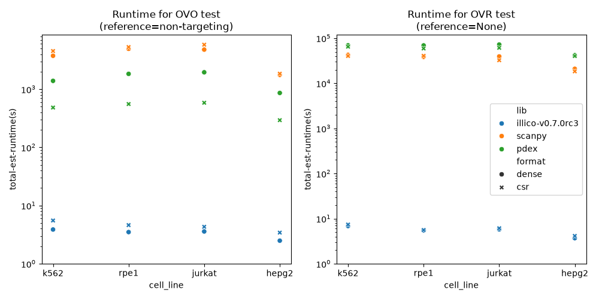
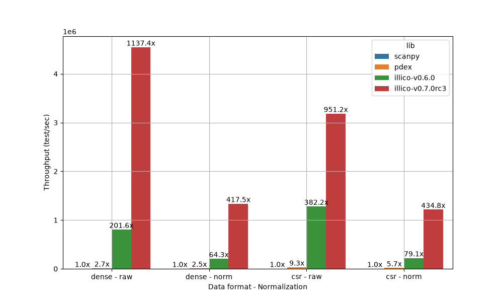
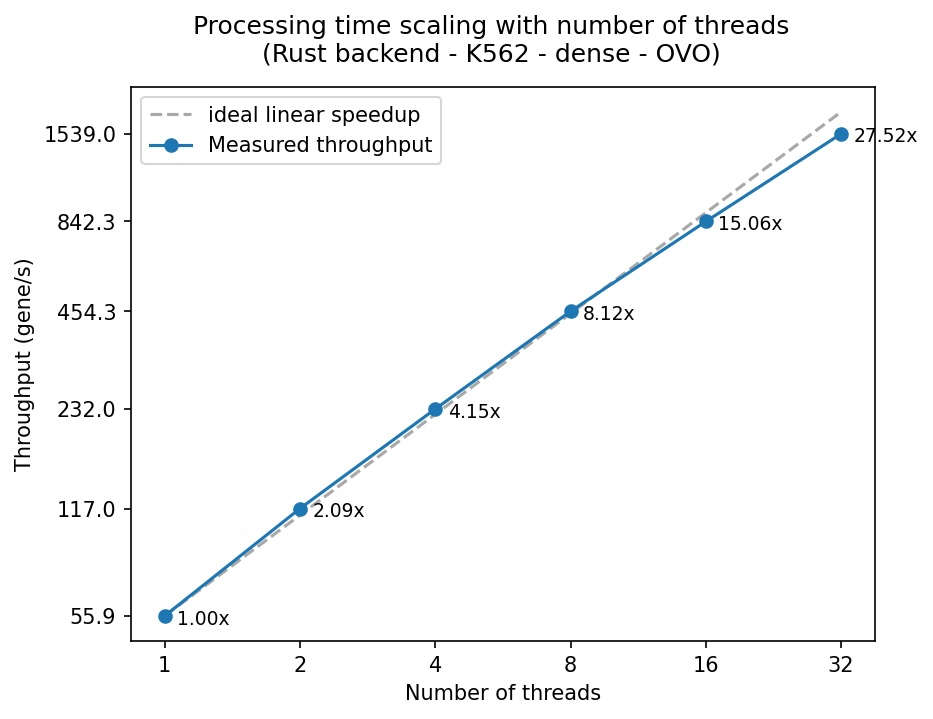
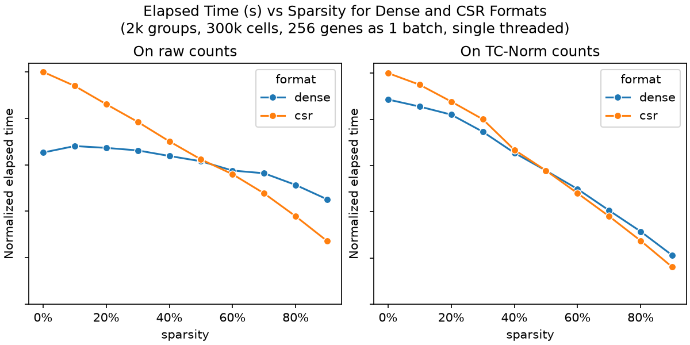

# Benchmarks

## Benchmarking against other solutions

A *benchmark* is defined by:

1. The cell line (K562 essential, RPE1, Hep-G2, Jurkat) used as input.
2. The data format (CSR, or dense) used to contain the expression matrix.
3. The test performed: OVO (`reference="non-targeting"`) or OVR (`reference=None`).

  
  <figcaption>Runtime comparison for scanpy, pdex and illico on four cell lines.</figcaption>

## Impact of normalization
Applying total count normalization (`sc.pp.normalize`) to your count matrix will make `illico` run 2x-3x slower. This is essentially due to two things:
1. Non-round values forbid the use of fast sorting algorithm like radix or histogram sort, and fallback to the slower quicksort.
2. Total count normalization creates more tie blocks per column (more unique values per group), hence a longer processing time (as `illico` processes data tie block by tie block).
Version `0.7.0` helped this a lot for the OVO case, but a slowdown remains between raw (integer count) and TC-norm data. In all cases, `illico` remains >200x faster than `sc.tl.rank_genes_groups(method="wilcoxon")` (scanpy < v1.13).

  
  <figcaption>Illico and other solutions' throughput (reference="control") in different data format and normalization scenarii.</figcaption>

## Scalability

`illico` scales reasonably well with your compute budget, with a quasi-linear speedup up to 16 threads.

  
  <figcaption>Throughput of illico with increasing compute budget, compared to a perfect scaling.</figcaption>

## Impact of data format (dense or sparse)
From v0.7.0, processing count matrices stored as CSR is not necessarily much faster than those stored dense, and can be slower in some cases. This is due to the "data wrangling" part (chunking columns to form batches, slicing groups for the OVO test) that is more expensive for CSR matrices than dense arrays. Depending on the sparsity (% of zeros) of your count matrices, and whether the data is total count normalized (see section above on normalization), one storage format is faster than the other.
> TL/DR: on TC-norm data, dense and CSR run almost equally fast regardless the sparsity. On raw data, CSR runs faster only when sparsity is above 50%.
Note: the chunking of dense arrays was made faster in v0.7.0, making the dense path faster. The (sparse and dense) mannwhitney test was also made faster, increasing the weight of data wrangling in the overall execution of `asymptotic_wilcoxon`. In all cases, v0.7.0 is 3 to 5 times faster for the OVO case than v0.6.0 in the same setup (data format, normalization).

  
  <figcaption>Impact of sparsity on runtime for dense and CSR raw or TC-norm count matrices.</figcaption>

## Batching strategy
`illico` processes input `AnnData` by batches of columns (genes). The batch size is an important parameter to tune: increasing it will obviously increase memory consumption of `illico` but will shorten processing time by a large margin for CSR count matrices, and a small margin for dense count matrices. Because `illico` relies on multithreading to process those batches, the size of those batches can lead to great inefficiencies such as load imbalance or remainder batch, both leading to under-usage of the processing power. Given that dispatching a batch and processing it induces no (or a neglectible) fixed cost, one should design batches so that:
1. All batches take the same time to be processed by one processor (thread in our case)
2. The total number of batches is a multiple of the number of multiprocessors

Point number 1 is hard to achieve as in the case scenario of sparse data for instance, the processing time between two columns can be very different, if one is sparser than the other, but `illico` makes the hypothesis that this smoothes out over one batch.

:bulb: Note than one could perfect this mechanism for the CSR use case as each column's sparsity can be computed and known before forming the batches.

`illico` offers a hard or soft batch size setting mechanism:
- indicating an integer value will form batches of exactly this size except eventually the trailing batch that will be smaller.
- indicating "~<int>" such as "~256" or "~512" means the batch size can be guessed to be around this value & satisfy the two conditions described above.
Below find a comparison of the two strategies for the dense use case of the k562 cell line.

### For dense data

  
  <figcaption>Impact of the batching strategy on CPU usage and overall runtime for dense count matrices.</figcaption>

Figure above illustrates well both load imbalance and trailing batch problem when `batch_size=256`:

- Because `adata.n_vars=8563`, a batch size of 256 means 34 batches can be formed. With 8 CPUs, it means all 8 CPUs can process 4 batches each synchronously to begin with, but the last two batches are processed by only two CPUs (in this graph: number 1 and 6), leaving the other 6 CPUs idle. That's a waste of compute time.
- Because `8563%256 = 115`, the last batch only contains 115 columns. This can be seen at the tail CPU 1 usage over time where it still has one batch to process after the first 4 ones. As this batch is smaller, it takes less time to process hence CPU 1 usage drops before CPU 6 is done with its batch of 256 columns. That's another waste of compute time.

On the other hand, when batch_size is soft-hinted (here denoted as "auto"), CPU usage is uniform and none of the 8 CPUs sits idle. The overall processing time of the entire `AnnData` drops from 31 to 27 seconds, a 10% improvement.

### For CSR data

  
  <figcaption>Impact of the batching strategy on CPU usage and overall runtime for CSR count matrices.</figcaption>

As predicted before, the compute time for CSR data is not uniform across columns so batches should not only be designed by the number of columns, but rather by the number of non-zero values it contains. In the example above, CPU 3 somehow gets dispatched batches taking longer to be processed. In this case, the speedup brought by the soft-hinted batching strategy is closer to 5%.
